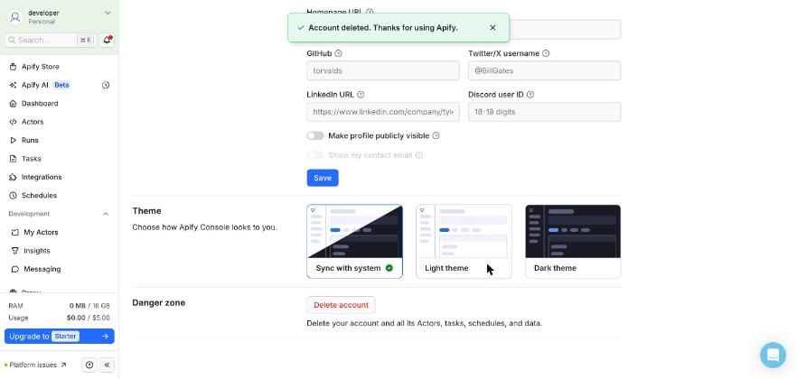

# Graveyard

Material cut from <cite>Did anyone README?</cite> before the product offsite on November 19, 2026, to fit 15 minutes.

*Cut, don’t delete.*

These aren’t TODOs. They’re kept for reference, reuse, or a longer version of the talk. Each entry has the slide source, ready to paste back into `index.md`.

## Cuts from the final talk

### Now it looks finished

```markdown
## Now it looks finished
```

A heading with nothing under it. The point lands when said out loud on the trust study slide.

### Our emotion rule catches one

```markdown
## Our emotion rule catches one

> We’re excited to announce…

> We’re glad you’re getting so much value…

<small>`ApifyUI.AssumedEmotion` flags only the first.</small>
```

“Glad? Aborted.” and “This deck does it too” already make the point. Better used for the Vale rule follow-up after the talk.

### Everything starts to sound the same

```markdown
## Everything starts to sound the same

> Clarity trumps consistency.

<small>Steve Krug, <cite>Don’t Make Me Think</cite>, via [DOC](https://www.doc.cc/syntax/consistency)</small>
```

Krug’s quote moved onto “Consistent mechanics. Not consistent thinking.” One slide instead of two.

### A design system needs custom work

```markdown
A design system needs custom work. So does our voice.
```

The line under “Consistent mechanics. Not consistent thinking.” It made way for Krug’s quote. Still a good line to say out loud.

### The tells keep moving

```markdown
## The tells keep moving

“Delve” faded in 2024. Now I see “, so.”

<small>“Delve”: [Automattic Design](https://automattic.design/2026/11/16/design-writing-working-with-ai-agents/), 2026</small>
```

“Old patterns, amplified” already shows patterns moving, and the “So” example opens the talk.

### This deck uses fragments too

```markdown
## This deck uses fragments too

> Glad? Aborted.

> Consistent mechanics. Not consistent thinking.

<small>I chose these. That’s the difference.</small>
```

Quoting the deck’s own slides in blockquotes made them look like more bad examples. Replaced with a plain statement.

### Fragments aren’t the problem

```markdown
## Fragments aren’t the problem

This deck is full of them. On purpose.
```

Followed “Glad? Aborted.”, which is about tone, not fragments, so it felt disconnected. The caption on “Old patterns, amplified” already says none of these marks is wrong.

### And when it’s done (toast screenshot)

```markdown
<!-- _class: screenshot -->

## And when it’s done



<small>Thanks, not guilt.</small>
```

Shows the toast in context on the Settings page. Replaced by the “Thanks, not guilt” text slide, since the toast is a small strip in a full-page screenshot. A tighter screenshot would bring it back. The image stays in `img/`.
