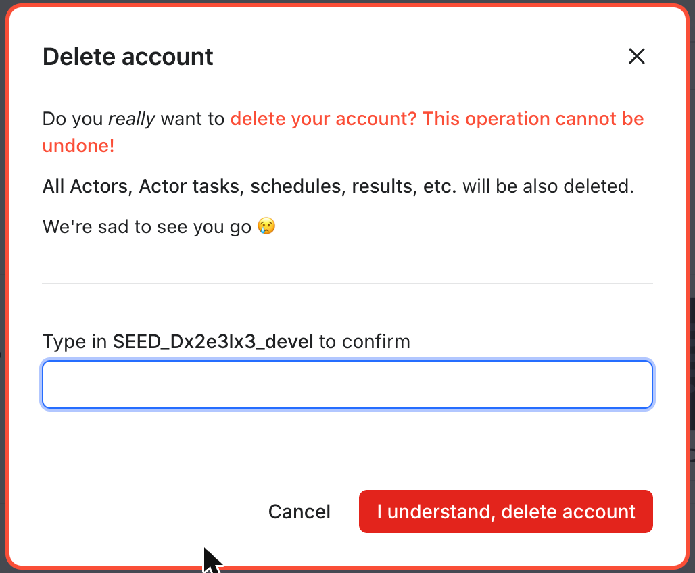
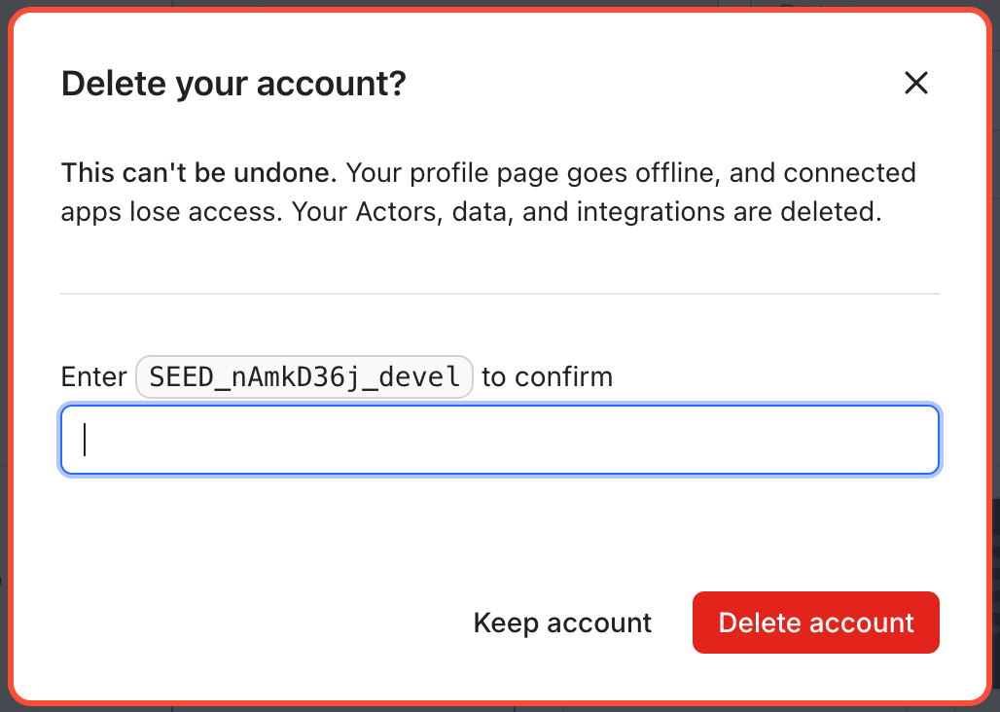
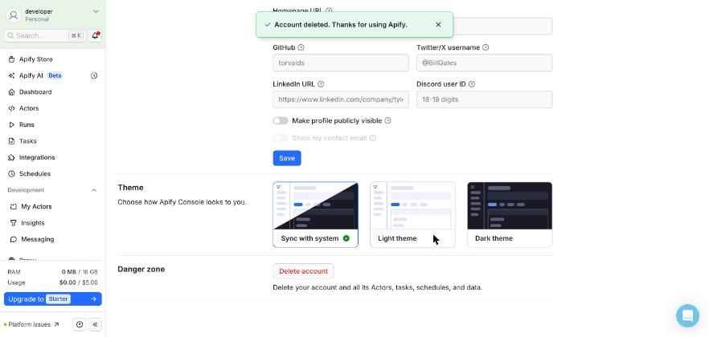
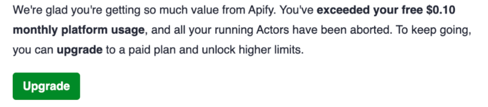
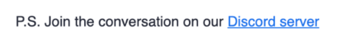

# Did anyone README?

**Product offsite, November 19, 2026**

Justin Gagne, Senior UX Writer 
`justin.gagne@apify.com`

---

## Why this talk?

More of our copy comes from agents.

It passes every check.

Did anyone read it?

---

<!-- _class: center -->

## How do people read on the web?

---

<!-- _class: center -->

> They don’t.

79% scanned. 16% read word by word.

<small>Jakob Nielsen, [Nielsen Norman Group](https://www.nngroup.com/articles/how-users-read-on-the-web/), 1997</small>

---

## Skimming isn’t new

We read about 20% of the words on a page.

<small>Nielsen Norman Group, [2008](https://www.nngroup.com/articles/how-little-do-users-read/). Still true in [2020](https://www.nngroup.com/articles/how-people-read-online/).</small>

---

## `README.md`

- The patterns that creep in
- A dialog we’re fixing, and an email we haven’t yet
- How to catch the next one

---

<!-- _class: center -->

## Did you choose that word?

Or is it habit?

---

## I do it too

| | Subscription canceled email |
| --- | --- |
| Before | As a result, your subscription has been canceled. |
| My “plain language” pass | **So** your subscription was canceled. |
| The next pass | Your subscription was canceled. |

---

## Our own rule suggests it

`'So ' instead of 'As a result, '`

<small>`Apify.SentenceStarts`</small>

---

<!-- _class: center -->

## Slop creep

“will be,” “cannot,” “right away,” “please,” “thank you for your patience,” “, so,” and “—”

---

## Nearly 300 copy fixes

| Pattern | Would our checks catch it? |
| --- | --- |
| “cannot” instead of “can’t” | Yes |
| Dashes | Yes |
| Repeats the heading | No |
| Promises the code can’t keep | No |

<small>From my apify-core PR reviews.</small>

---

## Even Star Trek’s android avoided contractions

He couldn’t tell when they fit.

<small>Adapted from [Ashley Bischoff](https://www.handcoding.com/presentations/betteraccessibility/). [Data (Star Trek)](https://memory-alpha.fandom.com/wiki/Data), Memory Alpha wiki.</small>

---

## Neither did our UI

| Before | After |
| --- | --- |
| Promo code {code} does not exist. | Promo code {code} doesn’t exist. |

<small>We’re Apify, not an early-2000s SaaS.</small>

---

## We have bad news

| Before | After |
| --- | --- |
| We have bad news: there is no API endpoint at this URL. Did you specify it correctly? | This URL isn’t an API endpoint. |

<small>Lead with the fact.</small>

---

## My own rule bit back

> Since no paying users, the monthly change limit doesn’t apply.

<small>My lint PR wrote this. A reviewer caught it.</small>

---

## Old patterns, amplified

| Mark | Example | Would our checks catch it? |
| --- | --- | --- |
| Em dash | It’s fast — and it’s free. | Yes |
| Mid-sentence colon | It’s simple: fast and free. | Sometimes |
| Full stop | Fast. Free. Yours. | No |

<small>None of these marks is wrong. Overuse is what’s new.</small>

---

<!-- _class: center -->

## Consistent mechanics. Not consistent thinking.

> Clarity trumps consistency.

<small>Steve Krug, <cite>Don’t Make Me Think</cite>, quoted in [DOC](https://www.doc.cc/syntax/consistency)</small>

---

## A dialog is a conversation

Someone is leaving. What do we say?

---

<!-- _class: screenshot -->

## Before

---

## We’re the adult in the room

Most people delete it the day they sign up.

Why make them feel guilty?

**Be clear. Be kind.**

---

<!-- _class: screenshot -->

## After (in progress)

<small>Say what happens. **Keep account** comes first.</small>

---

<!-- _class: screenshot -->

## And when it’s done

<small>Thanks, not guilt.</small>

---

## Did the screen reader README?

| Before | After |
| --- | --- |
| “Enter {name} to confirm, edit text” | “Delete your account?, dialog. This can’t be undone…” |

<small>Before: no dialog, no warning.</small>

---

<!-- _class: center -->

## It passed

---

<!-- _class: screenshot -->

## The usage limit email

---

<!-- _class: center -->

## Glad? Aborted.

---

## This deck does it too

> Glad? Aborted.

> Consistent mechanics. Not consistent thinking.

<small>I chose these. That’s the difference.</small>

---

<!-- _class: screenshot -->

## And at the end

<small>On every notification email, unless the code sets `skipMarketingFluff`.</small>

---

## What it could say

> You’ve had a busy month and exceeded your free $5 monthly platform usage. We’ve stopped your Actors until your next cycle starts on December 1.

<small>From my review on PR #32352.</small>

---

## And the P.S.

> P.S. Get help and share what you’re building on our Discord server.

---

## We say we check less when we trust AI

<small>319 knowledge workers. Lee and colleagues, [CHI 2025](https://doi.org/10.1145/3706598.3713778).</small>

---

## Reading is work

> It won’t do the work for you.

<small>Ursula K. Le Guin, <cite>Words Are My Matter</cite>, quoted in [A Working Library](https://aworkinglibrary.com/writing/against-disliteracy)</small>

---

<!-- _class: center -->

# Did anyone README?

---

## Skill or neglect?

**Skill:** the agent narrows what you read.

**Neglect:** the agent replaces the reading.

---

## Can you say why each sentence is there?

---

<!-- _class: center -->

# Check the output. Even a sample.

Start with errors, emails, and anything that can’t be undone.

---

<!-- _class: center -->

# README.

---

## Two README skills to try

- **readme-write**
- **readme-review**

<small>Pre-release. In `departments/marketing/.claude/skills/`.</small>

---

## The skills help. You still README.

Try them. Submit an issue. Slack me.

---

## Plain language, always

<!-- _class: small-table -->

| Rule | Instead of | Try |
|---|---|---|
| Keep sentences short: | One 40-word sentence held together with a dash. | Two sentences. Aim for about 20 words on average. |
| Use fewer syllables: | prior to, in order to, however, the following | before, to, but, this |
| Use plain words: | commence, sufficient, consequently | start, enough, so |
| Use contractions: | do not, cannot, will not | don’t, can’t, won’t |
| Check the reading level: | Grade 12 and up | Under grade 9 |
| Read it before it ships: | It passed. | I read it. Even a sample. |

<small>Adapted from [Ashley Bischoff](https://www.handcoding.com/presentations/betteraccessibility/). Reading level: [`Apify.Readability`](https://github.com/apify/vale-rules/blob/main/styles/Apify/Readability.yml).</small>

---

## What pattern did you see this week?

In your writing. In your agent’s.

---

## Thanks

Justin Gagne, `justin.gagne@apify.com`

<small>Apify Vale styles: [github.com/apify/vale-rules](https://github.com/apify/vale-rules)</small>
